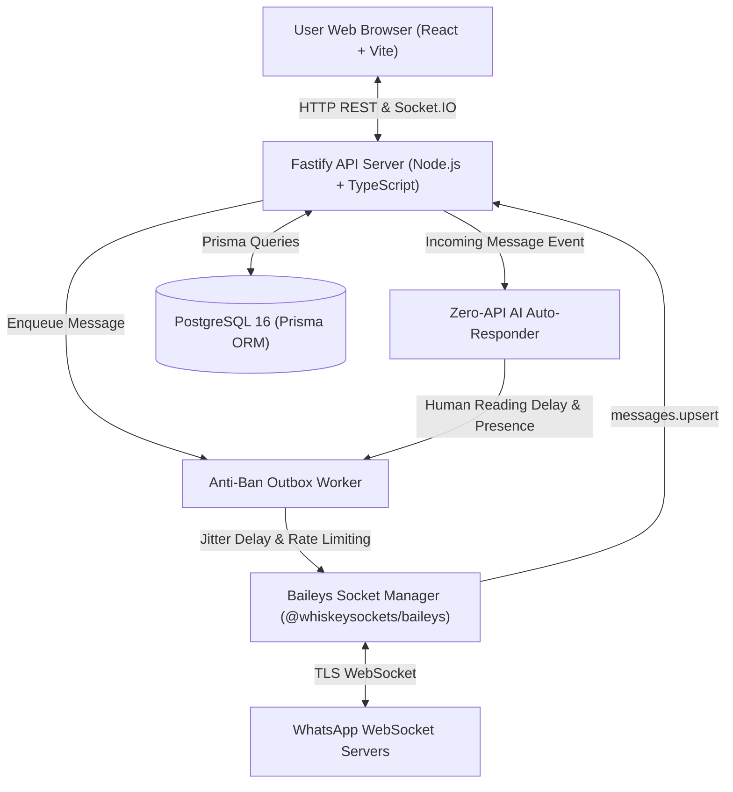

# Architecture & System Design

This document details the architectural design and internal data flows of the self-hosted WhatsApp Web client and automation engine.

---

## 1. System Overview

The application is structured into two primary tiers plus an encrypted persistence layer:

---

## 2. Core Modules & Folders

### Backend (`/backend`)
- **`src/whatsapp/sessionManager.ts`**: Manages the lifecycle of Baileys WebSockets (`makeWASocket`), authentication state loading, connection status tracking (`connecting`, `connected`, `qr`, `reconnecting`, `logged_out`), and self-healing signal sessions on decryption errors.
- **`src/whatsapp/authState.ts`**: Custom database-backed Signal auth store for PostgreSQL. Encrypts session credentials and pre-keys with AES-256-GCM.
- **`src/whatsapp/ingestionService.ts`**: Processes incoming and outgoing WhatsApp messages, updates chat metadata, downloads media files in the background, and emits real-time WebSocket events.
- **`src/whatsapp/messageParser.ts`**: Normalizes diverse WhatsApp message formats (text, image, video, audio voice notes, documents, system notices) into a unified relational schema.
- **`src/whatsapp/mergeService.ts`**: Unifies duplicate Linked Identity (LID) and Phone JID records into single canonical chat threads.
- **`src/services/sendQueue.ts`**: Anti-ban Outbox queue. Enforces sliding-window rate limits (20/min, 300/hr) and random jitter (1.5s–3.5s) between transmissions.
- **`src/services/aiResponderService.ts`**: Zero-API conversational concierge. Evaluates incoming text against local regex patterns, manages cooldowns, and coordinates human-like typing simulation.
- **`src/services/voiceConverter.ts`**: Converts recorded audio to WhatsApp-compliant Opus OGG format using bundled `ffmpeg-static`.
- **`src/services/linkPreviewService.ts`**: SSRF-safe OpenGraph metadata scraper with IP range restrictions and size limits.

### Frontend (`/frontend`)
- **`src/views/ChatsView.tsx`**: Main messaging interface with sidebar conversation list, active chat feed, and contact info drawer.
- **`src/views/SettingsView.tsx`**: Configuration center for AI auto-reply bio, URLs, cooldown timers, bulk chat toggles, and the interactive simulator.
- **`src/views/ConnectionView.tsx`**: QR code pairing and phone pairing code view.
- **`src/lib/socket.ts`**: Real-time Socket.IO synchronization client updating TanStack Query caches without full re-renders.
- **`src/components/chat/`**: Reusable UI components including `MessageBubble`, `AudioPlayer`, `MediaLightbox`, and `MessageInput`.

---

## 3. Message Lifecycle

1. **Incoming Flow**:
   - WhatsApp delivers an encrypted stanza over WebSocket.
   - Baileys decrypts the stanza using stored Signal session keys.
   - `sessionManager` receives the `messages.upsert` event and calls `ingestionService.ingestMessage`.
   - The message is stored in PostgreSQL, and a `message.new` event is emitted over Socket.IO to the frontend.
   - If AI auto-reply is enabled for the chat, `aiResponderService` evaluates the text.

2. **Outgoing Flow**:
   - A user or the AI submits an action via `sendQueue.enqueue`.
   - An optimistic message bubble is created and broadcast to the browser immediately.
   - The Outbox worker verifies sliding-window rate limits and applies human jitter delays.
   - The socket executes `sock.sendMessage`.
   - On confirmation, PostgreSQL is updated to `status: 'sent'`, and `message.updated` synchronizes the UI.
